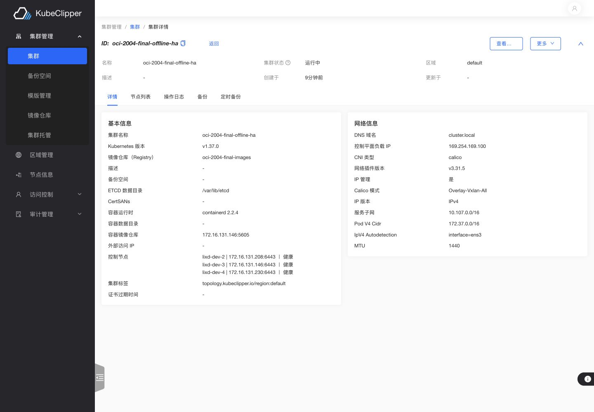

# OCI 三机全量复验（已完成既定 amd64 范围）

最终保留环境为用户 fork `lixd/kubeclipper` 的 `2004ce8bd69e527930ca666f846a9ef8117e9361`，平台 `v2.0.11`；Console 为 `94bac83135fb0fb2a18360b22aaf9de6bb8c9528`。三机为 sh-dev-2/3/4（172.16.131.208/146/230），Ubuntu24.04 amd64，各运行1个 Server、etcd成员和Agent；Kubernetes集群 `oci-2004-final-offline-ha` 为3Master/0Worker，三个节点及全部系统Pod Ready，Kubernetes1.37.0 / containerd2.2.4 / Calico3.31.5。最终 doctor **25 passed /0 warnings /0 failed**，运行中进程 SHA 与最新 CI 制品一致。

本轮192项台账：**190通过，2范围外，无失败/阻塞/待测**。其中公共CA项按原约定合并GHCR在线路径，不重复搭建；原生arm64因现有三机均amd64未执行，制品架构过滤另有验证。Tier1按现有清单仅Ubuntu24.04 amd64。逐项结果见 [cases.json](evidence/oci-20261103/cases.json)，最终状态见 [progress.json](evidence/oci-20261103/progress.json)。

本轮从旧平台起逐个候选重新执行；每项证据保留实际代码revision，不把前一候选结果冒充后一候选，也不声称190项全部在单一revision上重复执行。最后在2004ce8b重新闭环了修复回归、断网真实升级、HTTP新装、跨机bundle冷缓存纯离线新装/3Master建群、逐个实际镜像与payload摘要、六向Pod网络、已知凭据扫描、平台HA和最终进程验证。证据汇总见 [最终运行状态](evidence/oci-20261103/final-state-2004ce8b-proof.json)、[离线全链路](evidence/oci-20261103/final-pipeline-2004ce8b-proof.json)、[最终收尾](evidence/oci-20261103/final-close-2004ce8b-proof.json)。

所有代码、标签与报告仅写入用户fork；没有修改/提交上游，也未发布正式Release。允许替换的旧测试平台/集群已正常删除；共享Registry5003和NFS数据保留。最终保留5605内网镜像仓库、三机平台及上述Kubernetes集群供继续检查。公网隔离故障规则、回滚timer、临时代理drop-in/反向33917隧道、临时用户/SSH测试key和已完成的TLS/MinIO/TCP fixture均已撤除或停止；备份私密配置保留在各机本轮private目录0700/0600，不进入Git。Console28113转发保留供浏览器检查。

下文是各阶段的原始执行记录；其中“待测/正在/失败”描述当时状态，以本文顶部及台账最终结果为准。所有失败发现与对应修复证据均保留。在线GHCR路径使用了实验室代理；本轮无代理冷启动的证明来自真实断网内网仓库链路，不扩张为公网GHCR无代理可达性结论。

## 基线

2026-11-03 实际三机仍运行 71319775。集群 online-ens3-71319775 为 Running，三节点 Ready，Kubernetes v1.37.0 / containerd 2.2.4。dev-2 doctor 为 25 passed、0 warnings、0 failed。dev-3/4 默认 doctor 由于缺少 /root/.kc/config 失败；该检查结果不能解释为服务失败，也不能记为新版本通过。

每台保存了配置、旧二进制及 SHA256；dev-2 已额外保存 etcd 快照。含认证信息的恢复资料保存在各机 /root/kc-oci-5ffb1323-20261103/private，权限 0700/0600，不进入 Git。

## 制品准备

FAA 的 [Go 与 OCI 合约检查](https://github.com/lixd/kubeclipper/actions/runs/41618057426)及[完整 qualification 构建和同步回环](https://github.com/lixd/kubeclipper/actions/runs/41618057593)均成功。110 个制品引用包含 10 个 package、2 个 chart 和 98 个 runtime image，覆盖发布声明的 amd64/arm64；这不等于原生 arm64 真机验证。manifest SHA256 为 `42f9f8a692321c6b9cb4313337b735985f3fec8c22899272b114bb3cd5f92b80`。这些是 qualification 制品，没有发布正式 Release。

## 已完成的现场验证

FAA 于 10:26–10:29 UTC 通过正式 `kcctl upgrade all --manifest` 升级三机。运行中 `/proc/PID/exe` 与安装二进制 SHA256 一致。保留集群、节点 UID 和 Kubernetes ConfigMap marker 均未改变，三节点 Ready，doctor 25 passed / 0 warnings / 0 failed。该阶段验证升级现有平台与现有集群，不能替代全新部署/建群。

API/CLI 已验证：用户与角色 CRUD、RBAC 403、禁用/启用/改密/登录记录，短期 token 过期/刷新/撤销与限流恢复，真实隔离候选 Server 的 fake_sms MFA，DNS CRUD/输入校验，Registry 记录 CRUD、模板、资源 list/inspect/refresh、Delivery Policy 命令、bash/zsh 补全、审计查询、kubeconfig 下载后真实连接 Kubernetes、watch 实际收到更新、Operation/Task 游标分页。MFA 使用产品自带 fake_sms，不声明真实短信发送；token API 按当前 OAuth 契约验证；DNS 实际解析已发现删除缺陷，见下文。

备份验证包含真实 NFS 文件大小/MD5、恢复 ConfigMap marker、删除实际文件、16 次相同 Idempotency-Key 重放、不同参数 409、已删除备份重放 410、runAt、真实周期触发、enable/disable 和 maxBackupNum 自动轮转。专用 MinIO 的真实约 11.5MB 对象写入、恢复与删除通过；错误凭据产生明确失败。NFS CSI 的实际 RWX PVC 在 dev3 写入、dev4 读回，删除 PVC 后 PV 和后端目录清除，最后卸载 CSI。

Agent 停止后 Node Ready 转 Unknown，重启后恢复。分别停止 dev4 Server、etcd 时，其余 Server 仍健康且真实写入成功，恢复后 doctor 正常。两个并发证书更新请求允许排队：实际 Task 执行窗口分别为 10:53:19–10:53:47 与 10:53:47–10:54:19 UTC，没有重叠；更新后证书 serial 改变且 Kubernetes 写入成功。最初把 HTTP 200 排队误判为缺陷的实验分支未合入、未部署，并已撤除。

三节点网络探针的 6 个方向 ping/HTTP、每节点 DNS/Service HTTP 通过。首次探针因临时 HTTP Registry 未配置而 ImagePullBackOff；补上明确的测试 hosts.toml 后重跑成功，不把镜像拉取失败解释成网络成功。

真实浏览器登录、集群详情、Operation 列表和本轮 S3 错误任务的步骤/IP/失败信息展示已验证，截图 `evidence/oci-20261103/ui-task-failure.jpg`。后续 f5 候选在两套独立集群验证了真实 Pod exec、缺失 Pod/容器拒绝、集群 WebSocket 终端 resize 和 kubectl 执行；节点 SSH 终端及完整新建集群 UI 仍待验证。

## Registry 与离线物料

专用 HTTP Registry 为 dev3 的 5605，shared 5003 不变。61 个 amd64 制品首次同步成功，第二次 `0 copied / 61 skipped`。从镜像仓库导出 2,412,560,661 字节完整 bundle，跨机传到 dev4 后 SHA256 一致：`5c59f75dc15545ef17f984e86cae04f122bc5c0ef3309a0e7e16cbc92cb86684`。向空目标前缀连续导入两次，每次全部 61 个 digest 均匹配 bundle。完整断公网部署/建群仍待执行，导出导入通过本身不代表离线部署通过。

另已准备 5607 的专用自签 CA + htpasswd HTTPS Registry，匿名 401、正确凭据且严格 CA 校验 200；Package deploy/join/Agent 实际消费尚待验证。所有专用密码、私钥、恢复配置仅保存于远端 private 目录，不进入证据库。

## 本轮发现与修复

FAA 的真实 Task `task-1ea0c0681d0aec6427cda1a91cccfd2b` 在 offset=3520、limit=64 时返回 deliverySize=64，但 JSON 解码后内容为 66 字节。根因是 byte 分页切断 UTF-8，JSON 替换半个字符。`88d81ab5` 保留末尾半个字符供后续读取，并让极小 limit 仍能返回完整字符。新增中文/emoji 的 1/2/3/4/64 字节分页拼接与分次写入回归测试；旧代码失败，修复后 sh-dev Docker Go 1.26.1 的 operationv2、oplog、Operation API、CLI 和 TUI 测试全部通过。88d81ab5 的 [qualification](https://github.com/lixd/kubeclipper/actions/runs/41627552528)已成功。升级三机后，原始 6064 字节 Task 日志通过 95 个分页完整拼接，另一个 1542 字节日志通过 25 页拼接，两者均与整段读取逐字节一致；原失败 offset 现在返回 63 个完整 UTF-8 字节，无替换字符，5-12 已通过。

componentmeta 首次冷读耗时 128.362 秒，随后两次为约 30.6ms/23.9ms。功能响应与缓存有效已有证据；30 秒测试辅助程序超时不是已约定的产品 SLO，冷启动性能保留为观察项，不伪装成快速冷启动通过。

## 发布版本前置检查

首轮 qualification 按既有配置构建 v2.0.9，而现场 Server 为 v2.0.10-e2e.71319775；正常升级会触发降级拒绝。首轮执行已取消，不计为通过。将 release 与 kubeclipperVersion 同步为测试候选 v2.0.11-oci.20261103，保持降级保护不变，重新生成 qualification。dev-3/4 的 doctor --config 复查因旧 CLI 无此选项退出，保留为未完成；未复制认证资料修饰结果。

1477172b qualification 41616216648 未通过：发布策略校验发现内置 Delivery Policy 的 bootstrap 默认值仍为 v2.0.9。矩阵生成使用 echo 包住命令替换，掩盖子命令退出码，使 prepare 虚假成功后出现 fromJSON 空输入。同步内置版本，并拆分赋值与 echo，使失败在 prepare 明确返回；该失败不计为部署或测试通过。

平台首次升级在任何服务改动前被 ReleaseManifest 稳定版本格式约束拒绝（metadata.version 不接受预发布后缀）。这是本轮候选版本选择错误；配置统一为 v2.0.11，仍仅在 fork qualification 命名空间发布测试候选，不创建正式 Release。旧失败日志与制品保留，不伪装为成功；重新构建验证。

## 768933fb 与新装平台续测

旧三节点 Kubernetes 集群通过正常删除完成，随后关联 Operation 账本清除。正式 `clean --all` 后，从 88d81ab5 的 GHCR 重新部署 1 Server + 1 独立 Agent；初始密码正确接受、错误拒绝。重复 deploy 预检拒绝且保留 UID 和健康；正式 join 另外两台 Agent 后为 1 Server + 3 Agents，doctor 19/0/0。该阶段分别覆盖单 Agent、分离部署、多 Agent 和 Server/Agent 同机；不能替代三 Server 全新部署。

DNS 创建和更新已在真实 CoreDNS 生效，但删除 Domain 后 API 404、实际 DNS 仍返回旧记录，150 秒内未收敛。根因是 DNS Controller 在 NotFound 分支直接结束，没有重新同步 CoreDNS。768933fb 改为触发正常同步；新增删除最后一个域和保留其他域的两项控制器回归，旧代码均失败，修复后在 sh-dev Docker Go 1.26.1 通过。该候选 [Go](https://github.com/lixd/kubeclipper/actions/runs/41632579373)、[完整 qualification 与同步回环](https://github.com/lixd/kubeclipper/actions/runs/41632579584)成功，110 项清单 SHA256 `a04844985ce547f19ddb1044586efb2ca99f5e35bf64157c7e4e2fdafd6711ed`。12:31:11–12:33:34 UTC 完成正式平台升级，服务端及三 Agent 运行进程摘要与候选二进制一致；远端 Agent 机器上独立的旧 kcctl 不属于该次 CLI 主机升级范围。DNS 现场删除回归已通过：创建/更新实际解析，删除一个域保留另一域，删除最后一个域后 Corefile 清除并实际返回 NXDOMAIN。

88d81ab5 的完整 amd64 制品同步及跨机 bundle 导出/两次导入也已完成，61 个制品摘要均匹配。bundle 2,412,545,968 字节，SHA256 `a372df4b90a3724002fc4532f9c6879ce59dbbe0cfbbc08fdb1eda11b1b2c15d`。这仍不等于断网部署通过。

创建前 dryRun 已验证不支持 Kubernetes/CRI/CNI、Docker、Master/Worker 重复、CIDR 非法/重叠/主机冲突、禁用节点拒绝，并确认无 Cluster/Operation 创建。当前版本已移除 `--offline`，统一使用 OCI 取包；创建时镜像 Registry 显式选择优先，省略则补全平台已配置默认值，两者皆缺失时拒绝，显式错误引用不回退。2.1-33 已同步当前契约并保留历史说明。测试脚本的旧参数与不存在的 Node PUT 路由已修正，不将其作为产品缺陷。

在 dev4 专用 5609 端口，正式 `kcctl registry deploy/push/list/delete/clean` 完整执行通过；推送真实 Docker archive 后可见 repository/tag，删除后 manifest 404，clean 后服务与本轮数据移除。原有 registry 二进制和 CLI registry 配置按摘要恢复，共享 5003 未改动。

## d471 / f5 现场续测与占用节点缺陷

PDB 现场复现：已确认两副本健康、PDB observedGeneration 为最新、disruptionsAllowed=0，原实现仍移除 Worker。根因是 drain 前 NoExecute taint 直接触发驱逐，绕过 PDB。d471 删除前置 taint；旧代码回归失败，修复后 sh-dev Docker 的 k8s 与 clusteroperation 包通过。现场修复回归中，限制性 PDB 让原生移除明确超时且节点保留；删除本轮 PDB 后，原 Operation retry 成功，UID 与 steps SHA 不变。截图 ui-pdb-retry-d471fa27.jpg 保留原生任务日志。

f5 的完整 qualification 41644669502 与 Go 41644669722 成功；Console 94bac83 单测及正式构建成功。原生独立 upgrade server / agent / console / kcctl 完成，三机运行中二进制摘要一致，集群和 Node UID 保留。Console 详情已实际显示 Calico v3.31.5、当前镜像 Registry 名称和已配置的容器 Registry，修复截图 ui-cluster-details-94bac83.jpg。

缓存故障矩阵在 d471 真实增删 Worker 执行：有效缓存且外部 Registry 不可达时成功；损坏解压文件从已校验本地 OCI CAS 自动修复；解压文件损坏并移除必要 manifest blob 后，外部不可达明确 Failed，API 返回脱敏后的 network proxyconnect failed；恢复网络后原 Operation retry 从仓库恢复正确 SHA、Worker Ready、计划不变，无手动缓存恢复。辅助脚本原先错误要求日志包含私有代理端口；修正断言并重新注入故障后重新验证，未据手动清理声称自动修复。

f5 扩容发现新缺陷：API 接受另一真实集群的 Master，并启动 AddNodes。已取消该 Operation；取消前两个 Task 完成，原集群节点仍 Ready，但其 containerd 已从1.7.29变为2.2.4。公开证据 occupied-node-finding-f5dff3d8.json 记录该副作用。d2fd71f9 在写入前拒绝已有 master/worker 角色的节点；两种角色回归在旧实现失败，修复后整个 Core API 测试包通过。现场跨集群拒绝回归仍待执行，台账该项维持 failed。第二个集群随后正常删除、节点归属释放；通过原生 RemoveNodes 清理取消操作留下的目标拓扑条目，再原生加入 Worker，1M2W 全部 Ready。未直接编辑 etcd。

当前正在原生滚动升级 v1.36.4→v1.37.0，并在真实两副本 HTTP Service 上持续采样。控制平面升级曾短暂拒绝连接后恢复；最终 Task 状态、节点版本、滚动顺序与业务采样仍待核对，尚不记升级通过。HTTP 全制品镜像/导出及 TLS认证仓库消费、控制平面拓扑、平台 HA/离线重建、剩余 UI/故障场景继续执行。

滚动升级最终通过：1M2W 三节点均1.37.0/Ready，Task时间戳确认控制平面之后两个Worker逐个drain/upgrade/uncordon；1268次真实HTTP采样全部200且内容正确。随后原生升级平台至d2，三机运行中二进制摘要已核对。浏览器节点SSH终端真实输出本轮标记、lixd-dev-2、stty尺寸36×156，临时账号与2238监听器已清理，截图ui-node-terminal-d2fd71f9.jpg。

另发现权限缺陷：真实platform-view账号读取ConfigMap列表及deploy-config详情均为200，响应包含本轮初始管理员口令；未在证据中输出口令。匿名访问被403拒绝。根因是默认只读角色的`*/* get,list,watch`基础规则超出聚合查看模板权限，包含部署配置。52974228移除新装角色通配规则，并在升级启动时仅删除存量角色的旧通配规则，保留其他规则和聚合模板；不删除后续Server加入所需的部署认证配置。旧代码两项回归失败，修复后的Server及RBAC包在sh-dev Docker Go1.26.1通过。现场角色迁移、viewer拒绝、管理员/正常查看功能仍待验证，4-16维持failed。

d2的3M转换、etcd三成员健康、实际停止一个etcd后多数派连续写入、恢复第三成员、master→worker转换均已通过。显式加Master成功后，新成员首次短时health请求超时，后续实际三成员健康；不把首个探针成功作为前提。批量3→1移除被当前安全保护400拒绝且无Operation；修正旧测试脚本的拓扑预期后，3→2原生Master移除实际成员收敛健康。后续VIP/单Master接入模式检查仍在继续。未改变现有仲裁保护。

### 4dbec610 三机补测与 watch 路径补丁

三台实际运行进程与文件 SHA 已核验为 `4dbec610`，Console 为 `94bac83`。该版本包含只读角色权限修正、Cluster 列表/详情凭据投影及 VIP/hosts 修正。既有 Worker 的 single→multi→single API 映射切换已经原生操作复测通过，无现场手工 hosts 修补。

Console 向导真实创建 v1.37.0 / containerd2.2.4 / Calico3.31.5 的单Master集群，使用 iptables、IPIP、自定义 Pod/Service 网段和 DNS 域 `oci.test`。实际 Pod 解析 `kubernetes.default.svc.oci.test` 成功。第一次 CNI 安装失败源于本轮实验代理没有绕过自定义 DNS 域；修正 Agent 与 kubeadm 已生成的 kube-proxy NO_PROXY 后，同一 CreateCluster Operation、冻结步骤和 packagePlan 重试成功。该环境修正没有计为产品修复。

真实 Agent 停机使删除超时，Cluster 保留 TerminateFailed；恢复 Agent 后同一 Operation 重试完成删除并释放节点。脚本 finally 重复清理已移除的 transient timer 导致退出1，产品断言此前均通过；独立复核 Agent active、timer not-found、Cluster404、真实 nodeRole 标签消失。

只读账号的 DeployConfig GET/list 已返回403，普通与伪造 informer header 的 Cluster GET/list 均已脱敏。但现场 watch 事件使用 storage CacheableObject，4dbec610 的直接类型断言遗漏该包装，仍泄露 private CA / kubeconfig。补丁 `16309d2d` 复用现有项目的 runtime.CacheableObject.GetObject 处理方式；新增缓存 watch 与伪造 header 回归，旧实现失败、新实现整个 Core API 包通过（sh-dev Docker）。该补丁现场验收与完整 qualification 仍待完成，4-16 尚未关闭。

### 16309d2d watch 复验与节点复用发现

三机已升级至 `16309d2d`。真实 viewer 的普通及伪造 informer header 的 list/detail/watch 全部脱敏；DeployConfig GET/list403；429份Task日志与三机服务日志已知凭据扫描通过。native Console upgrade、UpgradeExtension 均成功且集群 packagePlan 不变；原生 set cluster 设置/清除4项外部访问配置通过。CLI配置优先级在私有Linux mount namespace验证通过，宿主配置字节/权限和Server PID不变。

[完整qualification](https://github.com/lixd/kubeclipper/actions/runs/41662687046)成功，manifest含110制品，SHA256 `7ef3f5e2818b306e22091d133a45fca04a1f57d6114044150bd6421c5403394d`。HTTP内网同步12 copied/49 skipped，严格自签CA+认证仓库同步12 copied；未使用skipTLSVerify。

`--only-install-kubernetes-component`现场发现新缺陷：正常Worker移除没有清理CNI配置/身份状态，新135集群虽然未安装Calico Pods，却继承旧的10-calico.conflist和calico-kubeconfig。凭据未打印；旧CNI CA与Main CA SHA相同，并与新集群不同。补丁 `c47158d0` 复用完整删除的3类清理步骤并仅针对离开节点、清理失败显式阻断；Master/Worker旧回归均失败，新k8s包通过。该补丁现场复验待完成，2.1-15未通过。

### c47158d0 挂载清理现场发现与修正

三台已升级c47158d0。真实disk/time/hostname预检负向已执行：原生precheck命令在空闲Agent的独立Operation运行，64MiB真实tmpfs、实际chrony停止、临时Linux非法hostname均被拒绝；诊断要求日志实际输出行，环境全部恢复。该测试不声称执行了整个集群安装。

新增节点清理中的递归removeCNIRunData遇到Calico挂载的cgroup2视图，现场Operation失败。此为本轮修复引入的遗漏，未计通过。确认kubelet停止且无运行CRI容器后，仅手工卸载/run/calico/cgroup，验证/sys/fs/cgroup保留；同一冻结Operation原生retry完成，此手工恢复不算产品修复验收。

补丁3e336bef移除节点/完整删除的运行目录shell递归删除，改由Calico本地清理读取现有mountinfo：只卸载自己的cgroup2视图、拒绝未知或未清掉的嵌套挂载，再删除普通运行目录；复用既有moby/sys/mountinfo依赖，无版本新增。旧shell安全回归失败，新k8s/CNI包测试通过。实际挂载清理闭环和无CNI重建仍待现场验证。

## 2004ce8b：凭据投影与 Calico busy mount 修复

外部 Provider 纳管现场发现只读用户可从 list/detail、伪造 raw header 和 cached watch 读到真实 SSH 私钥及 kubeconfig。c7c9895 根据实际 update 权限决定是否返回凭据，保留可信内部控制器及有编辑权限用户的原有契约；真实只读 JWT 的分页、详情、raw 和两条 watch 均脱敏，管理员 JWT 仍能编辑，内部纳管正常。真实日志、三机 journal、Registry API 与审计 API 的 11 类本轮已知凭据扫描通过，不宣称对任意业务 stdout 自动脱敏。

节点重用现场重现普通 umount 遇到 Calico cgroup busy view 的 EBUSY。2004ce8b 在精确允许的 `/run/calico/cgroup` cgroup2 挂载上使用 MNT_DETACH，随后仍重新检查挂载再删除目录；宿主 `/sys/fs/cgroup` 保留。独立 Linux mount namespace 的真实挂载回归在旧实现失败，修复后通过。原失败 RemoveNodes Operation 在同 UID/冻结 steps 上原生重试成功，节点再建 OnlyK8s 1.35.8 无实际 CNI 配置/凭据和 Calico Pod；正常删除后重新加入 Calico 1.37 集群，节点和双副本业务恢复。没有人工 umount 冒充自动清理。

外部 kubeadm 集群分别验证已有 Agent 复用、缺失 Agent 从本 fork OCI 引导、原节点 UID 保留与真实 API 写。解除纳管删除仅归其拥有的新 Agent，外部 Kubernetes 仍 Ready、UID 不变且真实写读删成功。验证后才对本轮自建外部集群执行独立 fixture reset，再正常删除剩余测试集群；三机 kubelet inactive、Calico view 与实际 CNI 文件均清除，宿主 cgroup2、共享 Registry 5003 和 NFS exports 保留。

2004ce8b 的 [完整 qualification](https://github.com/lixd/kubeclipper/actions/runs/41684295043) 与 [Go CI](https://github.com/lixd/kubeclipper/actions/runs/41684295289) 成功；完整 110 项清单 SHA256 `e23109a974c04e20f4c6696cbd618b0818897ee08613c021503a8f43aa1c4179`。原生 HTTP registry sync 为 12 copied /49 digest-matched skipped，TLS 认证仓库的 12 packages/charts 同步通过。均为 fork qualification，无正式 Release。完整断网消费链路仍在执行。

## 收尾重建与离线升级基线

全新严格 TLS/账号密码仓库部署采用 `3e336bef` 作为实际升级起点，三 Server、三 etcd 成员、三 Agent 全部健康，doctor 25 passed /0 warnings /0 failed。冷启动时明确阻断配置中的 etcd peer 12380，三机 client 12379 已监听，原生 Put 写探针仍失败并重试；恢复 peer 通信后原 deploy 自动继续完成。首轮脚本误用标准 2379/2380 未命中，不计故障用例通过。三个 API 端点分别完成真实 Role 写读删，etcd member list 为三成员。

该 TLS 基线上实际创建 Kubernetes1.37.0/containerd2.2.4/Calico3.31.5 的1M2W集群。三 Agent 的严格 CA、账号和密码配置逐项比较，冻结 PackagePlan 全部指向 TLS 仓库；全部节点及系统 Pod Ready，所有实际容器和 initContainer 的 imageID 与最新完整清单摘要匹配。真实 Pod Service HTTP 和绝对集群域名解析通过。该基线用于下一步真实 `3e336bef→2004ce8b` 离线升级，不将同版本重装冒充升级。

最新2004ce8b完整amd64 bundle为61项，2,412,562,329字节，跨机SHA256 `f991b8303743aceaf5ebd7feec9dc004366cc6d60ae0821086dd995009557966`；dev3导出、dev4校验后向初始为空的 `offline-shipped-2004` 前缀导入，两次导入的61个manifest摘要均匹配。纯离线部署消费仍在执行，以上导入结果不单独代表部署通过。

## 最终2004ce8b闭环

`3e336bef→2004ce8b` 是真实二进制变化的原生 `upgrade all --manifest`，全部制品来自搬运导入后的内网仓库，三机直连公网/反向代理均实测失败。Node/Cluster UID及原冻结PackagePlan保持不变，升级后业务HTTP与doctor通过；没有据一次HTTP检查宣称全程零中断。随后原生删除TLS测试集群，三机实际CNI配置凭据、Calico挂载与containerd镜像缓存均移除，宿主cgroup2保留。API三Server全部停止后，使用保存的实际3Server部署配置原生force clean成功。全新HTTP sync目标仓库消费也已通过。

最后正常clean，三机旧取包缓存隔离且runtime镜像缓存已原生清除，公网OUTPUT/FORWARD及loopback代理强制拒绝。仅使用 `offline-shipped-2004` 搬运仓库重新部署3Server/3Agent，再原生新建3Master Kubernetes1.37集群；全部节点/系统Pod Ready。逐个实际系统容器和initContainer imageID匹配清单；三机原生receipt、OCI CAS manifest、所有payload文件/Helm chart摘要匹配冻结计划与2004包来源，无手工缓存复制。六个方向的真实Pod ping/HTTP、三个节点的集群DNS成功，三节点Pod及主机公网HTTPS均被实测阻断。

最终平台viewer的ConfigMap拒绝、Cluster list/detail/raw伪造与两条cached watch脱敏、真实Task日志/三机journal/审计的已知测试凭据扫描通过；不宣称对任意业务stdout自动脱敏。撤除本轮隔离规则和临时代理配置后，逐台重启Server/Agent，平台与Kubernetes UID/计划、实际业务HTTP保留。修复版上分别停止dev4 Server、etcd时，其余两台API健康且真实Role写读删成功；恢复后doctor正常。最终运行中Server/Agent、已安装CLI的SHA均与2004制品匹配，无HTTP/2强制关闭。

真实浏览器重新登录并刷新最终集群详情，显示运行中、三个控制节点健康及正确Kubernetes/CRI/CNI/Registry字段。截图如下，公开证据提交前另作已知真实凭据扫描。

