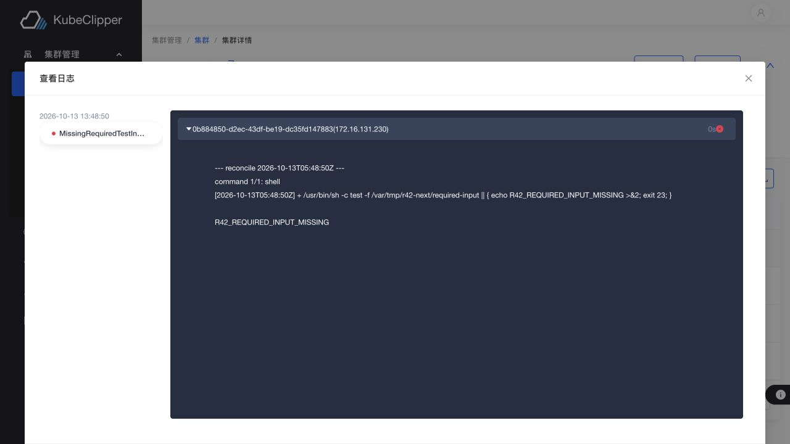

# R42 三机全量 Case 执行报告

> 后续R43补测已更新为通过185、部分4、失败0、阻塞2、范围外3；最新结论和候选证据见 [R43报告](status-2026-10-13-r43.md)。下文保留R42各时点的历史记录。

日期：2026-10-12（Asia/Shanghai）  
测试仓库：`/Users/lixueduan/17x/tmp/kc-oci-inventory-fix`  
分支：`feat/oci-operation-v2-migration`，HEAD `3e339e40`  
候选平台：KubeClipper `v2.0.3-rc.34`，gitCommit `5ce8f2dc`  
环境：`sh-dev-2`、`sh-dev-3`、`sh-dev-4`（Ubuntu 24.04 amd64）

## 执行结论

194 条 Case 已逐条归档，rc.34 初测结果为：**通过 88、部分 42、失败 7、阻塞 55、范围外 2**。初测中 137 条有全部或部分实测证据。完整逐条证据见 [R42 Case 台账](./r42-case-ledger.md)。

初测失败项补测后曾有一版快照：通过 110、部分 30、失败 0、阻塞 52、范围外 2。`2.1-25` 在线安装通过本地 7890 代理复测；其余 6 个初测失败项通过补丁构建复测。本轮完成升级竞态修复后的真实滚动升级、失败 Operation 的 CLI retry、外部 API SAN 验收，以及 Console 独立升级；rc.34 初测的 88/42/7/55/2 原始统计保持不变。

rc.34 初测没有做到 194 条全部技术执行，不能报告“全部通过”。初测失败项集中在代码缺陷和测试环境限制；补丁构建三机复测结果见后文。

rc.34 初测失败项集中在以下问题：

- `1.3-12`、`4-16`：初始口令格式校验错误把输入值回显到 CLI 输出。
- `2.1-25`：在线建群拉取 `registry.k8s.io/kube-apiserver:v1.37.0` 时跳转到 `europe-west4-docker.pkg.dev` 后连接超时。
- `2.3-08`：同版本 `v1.37.0` 与降级 `v1.36.4` 的 upgrade dry-run 均返回 HTTP 200；只有不支持版本返回 400。
- `2.5-08`：`maxBackupNum=2` 的 CronBackup 连续运行 6 分钟仍保留 7 个可用备份。
- `4-12a`：SSH Web Terminal E2E 的 WebSocket 握手失败。
- `5-11`：Operation 分页第二页请求返回 HTTP 504 `Too large resource version`。

## 测试计划与逐步执行

1. **基线与保护边界**：盘点三台主机、平台、集群和 OCI Registry；保留 `sh-dev-3` 上独立 Registry `172.16.131.146:5003`，不清理它的制品或服务。
2. **旧环境清理与候选部署**：清理旧 KubeClipper 测试环境，部署候选 HA 平台；执行自动化测试及发布策略检查。
3. **逐项执行 Case**：按第 1 至第 7 章执行 CLI、平台拓扑、集群矩阵、备份/恢复、API/UI/RBAC、Addon、Operation 和发布场景；证据实时记入 Case 台账。
4. **拓扑切换与故障收敛**：测试 HA、单 server+单 agent、独立 join、drain、Kubernetes 版本矩阵、代理模式、外部 CA、跳过 CNI、在线拉取失败、取消与失败集群删除。
5. **收尾**：删除临时对象与集群，停平台服务，核验 K8s/CNI 残留、SSH 和共享 Registry。

### 第 1 步：基线

- 三台测试机均为 Ubuntu 24.04 amd64。测试时平台候选为 `v2.0.3-rc.34`。
- 共享 HTTP Package Registry `172.16.131.146:5003` 可用；保留其独立服务 `kc-oci-r3-registry`。
- 初测阶段未修改业务代码；后续复测为 master kubelet 重启增加稳定就绪门禁和回归断言，细节见本报告追加章节。

### 第 2 步：部署与自动化检查

- 清理旧平台后部署 3 server、3 etcd、3 agent、console 的 HA 拓扑；`kcctl doctor` 为 25 passed、0 warning、0 failed。HA server/etcd 单点与滚动重启恢复通过。
- 后续 clean 并部署单 server（sh-dev-2）+ 单 agent（sh-dev-3），`kcctl status` Healthy、doctor 15 passed；`kcctl join` 加入 sh-dev-4 后为 2/2 agents。重复 deploy 在 etcd 预检被安全拒绝；`kcctl drain` 成功注销 sh-dev-4。
- `go test ./...`：多数包通过；`pkg/utils/systemctl` 因本机 macOS 没有 DBus socket 失败。
- `NO_PROXY=127.0.0.1,localhost HOME=/tmp/kc-r42-e2e-home go test ./test/e2e -count=1 -v -timeout=45m`：16 specs，6 通过、10 失败。失败由 `registry.k8s.io` 拉取、缺 `e2e-bp` fixture、HA 节点不足、SSH WebSocket 握手失败、Registry 清理钩子重复注册引起。
- `go run ./tools/release-policy-verify --manifest packaging/resources.yaml` 通过；`scripts/open-packaging/tests/*.sh` 7 个脚本通过，shell 语法检查通过。

### 第 3 步：Kubernetes 与备份场景

- 真实创建 1 master+2 worker 集群，验证三节点 Ready、系统 Pod、API readyz；执行 worker 扩缩、master/worker 转换、disable/enable、backup/restore marker 回滚和正常删除。
- rc.34 初测的 `v1.36.4→v1.37.0` 升级曾出现一个 master Task 失败及 kubeadm-config 版本未同步；追加复测定位为 master kubelet 重启时 API 短暂中断，已增加稳定就绪门禁并用新构建重跑。新 Operation 六步全部成功，两节点及 kubeadm-config 均为 v1.37.0；升级后 packagePlan slots 为 k8s v1.37.0、containerd 2.2.4、Calico v3.31.5、extension v1。
- 单节点 `v1.35.8 + containerd 1.7.29 + Calico 3.29.6` 集群 Ready，实际 kube-proxy 为 ipvs，Calico VXLAN 与 `interface=ens3` 自动探测生效。
- 单节点 `iptables` 集群 Ready，所有系统 Pod Running；外部自签 CA 指纹与节点 CA 一致，feature gate 和 `NumCPU` ignore 参数进入实际 Operation 输入。另建 `--only-install-kubernetes-component` 集群，Task 步骤无 Calico 安装，CoreDNS Pending、节点 NotReady，符合跳过 CNI 的状态。
- `--offline=false` 在线建群因公共 Registry 重定向地址无法连接而失败。取消 Operation 后集群进入 InstallFailed，普通 `kcctl delete cluster` 成功清理。
- CronBackup 的 runAt 首轮因所有节点缺少目标目录失败；创建隔离目录后 API retry 成功并生成约 17.3 MB 备份。周期触发与 disable/enable 通过；`maxBackupNum` 自动轮转失败，7 个 Available 备份未被清除。收尾时 10 个本轮 CronBackup 文件和记录均按删除操作清理。

### 第 4 步：API、CLI、权限和 Operation

- 验证用户/角色、登录、禁用/启用、改密、登录记录、RBAC 403、登录限流恢复、集群模板引用保护、DNS domain/record CRUD、kubeconfig 下载、audit events、metrics 与平台自省。
- `kcctl operation cancel` 取消在线建群 Operation 成功；Task 节点 UID/IP、steps、日志 offset 查询通过。Operation 分页第二页复现 HTTP 504。
- Console 可查看集群列表和详情；platform-view 用户的 Operation 页面无记录，未完成管理员视角任务失败展示验收。
- 初测时 Addon/S3 依赖未就绪；后续在 dev4 的现有 NFS export 子目录与临时 SeaweedFS S3 服务上补测 NFS CSI、MetalLB L2/BGP 和 S3 备份，详见本报告“部分/阻塞 Case 复核”章节。

### 第 5 步：最终清理与审计

- 所有本轮测试集群均通过正常删除或 InstallFailed 清理路径移除；CronBackup、BackupPoint、临时用户与测试配置随最终 clean 移除。
- 执行 `kcctl clean --all --force --deploy-config`，三机 `kc-server`、`kc-agent`、`kc-etcd`、`kc-console`、`kubelet`、`containerd` 均 inactive。
- sh-dev-2 和 sh-dev-4 上 K8s/CNI 残留目录已清除；sh-dev-3 的 Docker 与共享 Registry 在运行，保留其 CNI 目录。
- `sh-dev-3` 的 `kc-oci-r3-registry` 仍 active，`http://127.0.0.1:5003/v2/` 返回 HTTP 200；三台 SSH 连接正常。三机 `/opt/kc/backups/r42-cron` 均不存在。

## 阻塞项与后续条件

- 补充可执行的 ReleaseManifest、在线发布源与离线 bundle，才能完成当前候选的在线直装、registry sync、平台升级与完整制品 provenance 验收。
- 本轮已用隔离 NFS export 子目录、Registry 内 NFS/MetalLB runtime images 和 SeaweedFS S3 endpoint 覆盖 Addon/S3 协议路径；MinIO 兼容性专项仍未测，Addon OCI chart/ReleaseManifest 仍缺。
- 当前三机只有 amd64、default Region；arm64 路径、3 master+独立 worker 的四节点拓扑、第二 Region、公共 CA 域名与第三方 OIDC IdP 仍需要对应硬件或外部服务。
- 真实断网、可路由跨子网/BGP peer、Registry 暂时不可达、缓存破坏与 Operation 内部时序故障注入尚未在本轮完成；不能将历史测试或代码级覆盖算成本轮现场复测。
- 初测发现的密码错误回显、CronBackup 超限轮转、同版本/降级升级接受、Operation 游标分页 504 已完成源码修复、定向验证和补丁构建复测。升级 Task 竞态也已修复并通过新的真实滚动升级复测；业务流量连续性和自动 retry 仍未单独验证。

## 失败项根因与补丁构建三机复测（追加结果）

以下记录初测失败根因、代码级处理和补丁构建现场复测。补丁服务端二进制 SHA-256 为 f46e8e5a963f0efd6be3a79783922bc2fd404a508f3423b4d3392e4b095fd767，三台服务端安装内容一致；原始 rc.34 初测统计保持不变。

| Case | 复核结论 | 本地处理与定向验证 | 补丁构建三机复测 |
|---|---|---|---|
| `1.3-12`、`4-16` | 弱口令拒绝路径把用户输入拼进错误字符串；是旧路径遗漏的敏感信息泄漏，不是 R42 才引入。 | 错误改为固定文本并新增不回显断言；pkg/authentication/options 定向测试通过。 | 重编 kcctl 现场提交弱口令；拒绝提示固定为 password format error，不含测试输入串。两个 Case 通过。 |
| `2.1-25` | 初测在线建群拉取公共镜像时被 307 重定向至 europe-west4-docker.pkg.dev，目标地址连接超时；证据指向测试环境出口限制，未定位到代码缺陷。 | 未修改代码。 | 用户确认使用本地 `127.0.0.1:7890` 代理后，通过 SSH loopback 反向隧道和临时 systemd 代理环境变量复测。首次代理尝试的 `NO_PROXY` 漏含内部 API 域名，取消并删除集群后修正；第二次 Operation `04cda3ff-2098-4eb5-b3a9-925f754e5e5e` 成功，Kubernetes v1.37.0 / containerd 2.2.4，sh-dev-3/4 均 Ready，Calico 与 CoreDNS Running，公共 Registry 镜像拉取完成。Case 通过。 |
| `2.3-08` | CLI 有升级版本保护，但 API handler 缺少相同校验；API dry-run 绕过 CLI 检查。 | 抽取 CLI/API 共用的语义版本校验；API 在 dry-run 前拒绝同版本、降级和不支持范围；校验、handler 定向测试通过，CLI 包编译通过。 | patched server 上同版本 v1.37.0 与降级 v1.36.4 的 API dry-run 均返回 HTTP 400；不支持目标版本在 R42 初测也已 HTTP 400。未创建升级 Operation，失败子场景均通过。 |
| `2.5-08` | 删除 Operation 缺少可用于探测 apiserver 的 master IPv4，初测日志复现 ErrNoReachableMaster。 | 删除 Operation 从 NodeLister 取得 master IPv4；控制器定向测试通过。 | maxBackupNum=2 每分钟触发；7 次 BackupCluster 成功，5 次轮转 DeleteBackup 全成功。每轮后 API 和 FS 均留 2 份 Available 备份，ErrNoReachableMaster=0。通过。 |
| `4-12a` | E2E 使用 ws:// 连接 HTTPS 服务导致握手失败；改为 wss 后还需把 TLS ALPN 限制为 HTTP/1.1。现场 Agent 初始 IPDetect 选到不可路由 bridge 地址，故测试环境改用 ens3。 | query 改用 net/url.Values；按服务 scheme 构造 WebSocket 并复用 TLS 设置、指定 HTTP/1.1 ALPN；E2E 包编译通过。 | sh-dev-2 执行聚焦 SSH terminal 的 TestRunE2ETests，1 passed；跨节点完成连接、检查、关闭。使用的临时 SSH 用户已删除。通过。 |
| `5-11` | Operation V2 分页第二页初测复现 HTTP 504；watch cache 版本不同步是代码分析推断。 | strong storage 下的分页读取绕过 watch cache；分页单测通过。 | limit=1 连续遍历 10 页、10 条唯一 Operation 记录，每页 HTTP 200，游标正确前进，未复现 504。通过。 |

上述源码验证结果：pkg/authentication/options、pkg/scheme/core/validation、pkg/apis/core/v1、pkg/controller/cronbackupcontroller、pkg/models/operationv2 定向测试均通过；pkg/cli/cluster 编译通过；E2E 包编译通过，随后执行的 SSH terminal 聚焦 E2E 另在补丁构建三机复测中通过。源码与现场证据分别列出。

### 为什么旧记录里曾经是通过

- `1.3-12` 的 R22 主要覆盖初始化密码生效、配置优先级及日志/配置文件不泄漏；没有触发“弱口令被拒绝后检查错误文本”的分支。`4-16` 的 R23 检查了配置、日志、API、审计和 metrics 的泄漏面，也没覆盖该错误文本，因此这是此前用例覆盖遗漏。
- `2.3-08` 的 R3/R7 通过记录覆盖 CLI/旧 Operation 路径；R42 失败是直接调用 API dry-run，实际入口不同。
- `2.5-08` 的 R11 是 rc.8 上真实轮转通过记录；但源码历史显示 ID-only metadata 当时已经存在。R42 在 `rc.34` 的日志明确复现 7 次删除失败，精确的历史差异尚未查明，可能与当时节点拓扑/探测结果有关，不能用本地推测替代对照复测。
- `4-12a` 的 R32 验证 Console 终端行为；R42 自动化 E2E 的 TLS scheme/ALPN 与测试节点 IPDetect 设置不匹配，修正后 SSH terminal 聚焦复测通过。
- `5-11` 的 R3 验证的是旧 Operation 列表实现；R42 测的是 Operation V2 的稳定游标分页。
- `2.1-25` 的 R6 通过发生在此前网络和候选环境；R42 初测时公共镜像重定向地址超时。接入本地代理后，同一在线安装场景通过，说明失败来自测试出口可达性，而非已发现的代码缺陷。

### 补丁复测收尾

- 删除测试 CronBackup、两条剩余 Backup 和 BackupPoint；Backup API 记录为 0，三台 FS 测试目录均已删除。
- 正常删除 r42-rerun-offline 集群后执行 kcctl clean -A -y。sh-dev-2/3/4 的 kc-server、kc-agent、kc-etcd、kc-console、kubelet、containerd 均 inactive；测试账户 kc-e2e-r42 与临时文件目录已移除。
- sh-dev-3 的共享 kc-oci-r3-registry 保持 active，http://127.0.0.1:5003/v2/ 返回 HTTP 200。
- 用户确认启用本地 7890 代理后，在线集群 `r42-proxy-online` 的 CreateCluster Operation `04cda3ff-2098-4eb5-b3a9-925f754e5e5e` 与 SyncKubeConfig Operation `sync-kubeconfig-79614bd0-7e9d-4d10-9305-5fda08a14c4f` 均 Succeeded；两台节点 Ready，Calico 和 CoreDNS 正常。随后正常删除集群并再次执行 `kcctl clean -A -y`。
- 本次临时 SSH 反向隧道已停止；sh-dev-3/4 上的代理 drop-in 已删除，端口 17890 无监听。sh-dev-2/3/4 平台及 kubelet/containerd 均 inactive；sh-dev-4 的空 Kubernetes/CNI 残留目录已清除。共享 `kc-oci-r3-registry` 仍 active，`/v2/` 返回 HTTP 200。

R41 报告中的 `190/194` 是针对 R40 单项发现⑦的修复轮状态快照，不是对 194 项逐项重新执行；详见 [R41 报告](./status-2026-10-11-r41.md)。因此不能把 R41 的全表历史状态理解为和 R42 同版本、同入口、同环境的全量回归。

## 后续复测与最终收尾

### 升级稳定性与 Operation retry

- 根因：master kubelet 重启后 kube-apiserver 静态 Pod 会短暂重建。旧流程看到一次 `/readyz` 成功就继续执行 worker drain，偶发连接拒绝。`pkg/scheme/core/v1/k8s/cluster.go` 现在要求 `/readyz`、master Node Ready、`kube-apiserver-$node` Pod Ready 连续 7 次采样（间隔 5 秒），最长等待 240 秒；未稳定时明确失败。`go test ./pkg/scheme/core/v1/k8s -count=1` 通过。
- 在旧失败 Operation `e93a45d9-d8a1-40af-a90c-c81c666cb665` 上运行 `kcctl operation retry` 后，worker drain 重试及后续升级成功，覆盖 `2.3-02` 和 `3-11`。
- 使用补丁构建新建 1 master + 1 worker 的 `r42-upgrade-stablecheck`，初始 Kubernetes v1.36.4。UpgradeCluster Operation `2ed1c3b0-1fa6-48a3-a6be-a016c06d9552` 六步全部 Succeeded。控制面稳定门禁通过后才进入后续 drain；两节点最终 Ready v1.37.0，kubeadm-config 为 v1.37.0，`/readyz=ok`，系统 Pod 全 Ready。
- 升级后的 packagePlan slots 为 k8s v1.37.0、containerd 2.2.4、Calico v3.31.5、extension v1，OCI ref 与 digest 均可见。未运行持续业务流量探针，因此 `2.3-09` 继续保留部分状态。

### Console 独立升级与退役组件

- 首次 Console 升级被安全校验拒绝，是临时 ReleaseManifest 把 amd64 子 manifest digest 写入了需要 OCI index digest 的字段。Registry tag 的 index digest 为 `sha256:f49f55382f072490366b0df21d87c0b8a38fa4f9395596d5797a10ed73639e94`，其中 amd64 子 manifest digest 为 `sha256:adce2b3d7d5861511f2da16a16da892706c0f9f2bab61ef9f7be5e205dee26b3`；修正临时 manifest 后，`kcctl upgrade console --manifest ... --package-registry-scheme http -y` 成功。
- dev2 Console 当前 commit 为 `50f1a4a8d3b0c6bccc2b9b2a97aef2829d8c5549`，`kc-console` active，HTTP `/` 返回 200，dist bundle 无 `nfs-provisioner`。三台主机的 legacy static-server、nfs-provisioner、tar-downloader 服务/进程/二进制扫描均无匹配项；现有共享 NFS export 未修改。
- 因本轮仅复测 Console 独立升级，`1.3-10` 和 `3-17` 从阻塞调整为部分；server、agent、kcctl 独立升级仍未覆盖。`5-07` 的人工 retry 已通过，自动 retry 仍保留部分状态。逐行重算发现旧汇总少计了 3 条已标通过的 Case，现以上述 194 行统计为准。

### 另外两项部分 Case 复核

- `2.1-20`：离线创建 `r42-firstfound` 成功，Calico DaemonSet 实际设置 `IP_AUTODETECTION_METHOD=first-found`。日志显示 dev4 选中 `lxdbr0=10.8.39.1`，而 Kubernetes Node IP 是 `172.16.131.230`；dev3 到该地址的 ping 不通。`first-found` 在该多网卡主机上不适用；`interface=ens3` 和 `can-reach` 已有通过证据，因此整项保留部分，不将 Ready 状态当成跨节点流量通过。
- `1.3-01`：把 deploy 的 server 目标设为保留网段 `192.0.2.1`，SSH 预检在 60 秒后返回 `dial tcp 192.0.2.1:22: i/o timeout`，没有修改三台测试机；CLI 同时输出 Go stack trace。不可达子场景已有证据，独立缺包失败路径仍未执行，所以保留部分。
- `2.1-12`：隔离集群 `r42-api-publish` 保存 external IP `172.16.131.146`、domain `r42-api.example`、两种端口 `6443`；apiserver 证书 SAN 含自定义 SAN、外部 IP 和 domain。用集群 CA 直接经 IP、以及用 `curl --resolve` 经外部 domain 请求 `/readyz`，两者均返回 `ok`。该 Case 转为通过，集群已删除。

### Operation retry 与 Step barrier 代码级复核

- 本轮运行 `go test ./pkg/controller/operationv2 ./pkg/operationv2 -count=1`，两个包通过。`TestAutomaticRetryCreatesNewTaskAttempt` 验证失败 Task 会创建新的 Attempt 1，重试耗尽后 Operation 进入 Failed；`TestReconcileStepBarrierAndOutput` 验证后续 Step 使用前序 Task 输出。此前人工 API/CLI retry 和多节点 Operation 已有现场通过证据。
- `5-05`、`5-07` 仍保留部分：本轮无法用失效的本地 kcctl session 对当前服务做认证式 API 查询，也未在现场注入新的 Task 故障；代码级回归通过不能替代这两项现场验收。

### 最终环境状态

- `r42-upgrade-stablecheck` 已正常删除；集群对象不存在，dev3/dev4 的 kubelet、containerd inactive，`/etc/kubernetes/admin.conf` 已清除。
- dev2 server 与 dev3/dev4 agent 已恢复原 rc.34 二进制（SHA-256 分别为 `6871a352c3a7404e5ea33f3c3828296e3fa9346012a2b55c2822732e60bca4b4` 与 `c36c396e1310cc9d3376d0e412f1ddc6d745bb8a1878d6447d97e7a49b775cf5`）；平台 Healthy、2/2 agents。Console 的修复版本保留在 dev2。
- 共享 `kc-oci-r3-registry` 保持 active，`http://127.0.0.1:5003/v2/` 返回 HTTP 200；本轮没有改写共享 Registry tag 或制品。测试 staging 二进制、备份及临时 ReleaseManifest 已清理。

## 部分/阻塞 Case 复核（追加，2026-10-12）

### 复核计划与范围

1. 对原台账 30 条“部分”和 52 条“阻塞”逐条回看剩余验收条件及当前三机依赖。
2. 对能在隔离集群或临时服务上安全复现的路径现场重跑；需要第 4 台、arm64、第二 Region、当前候选 ReleaseManifest 或外部服务的用例保留阻塞，不用历史记录冒充本轮执行。
3. 删除临时集群、BackupPoint、S3 服务和 NFS 子目录，核验共享 Registry 与平台基线。

本轮并未把 82 条全部完整重跑。逐条状态按新证据重算为：**通过 121、部分 31、失败 0、阻塞 40、范围外 2**。原阻塞项中 10 条转为通过、2 条转为部分；原部分项中 1 条转为通过。因此并非“都没法测”，但仍有 40 条缺少当前完整验收证据或必要依赖。

### 本轮新增现场证据

| Case | 本轮结果 | 现场证据 |
|---|---|---|
| `4-01` NFS CSI | 通过 | `nfs-csi-v1` 安装 Operation 成功；动态 PVC Bound；dev3 writer 写入、dev4 reader 读回标记一致；完整配置卸载成功。另以默认 `nfs-sc` 验证空 config 卸载成功。 |
| `4-02` MetalLB L2 | 通过 | Install Operation `2d147ed0-6e6e-41b4-b9d0-d39526a3484a` 和 Uninstall Operation `3199a741-6d78-40b4-bc10-c97143ec0fa3` 均 Succeeded，controller/speaker Ready，卸载后资源清空。 |
| `4-03` MetalLB BGP | 通过 | 按已确认的“Addon 安装成功”口径，安装 `82635f4a-5715-47e1-b06f-f12211e52a4e` 与卸载 `4ec40d76-b44a-41bc-830e-5ba8c6dec3bd` 均 Succeeded，controller/speaker Ready；没有 BGP peer，未声称外部 VIP 数据面通过。 |
| `4-05` 空 config 卸载 | 通过 | 默认 StorageClass `nfs-sc` 安装后空 config 卸载 Operation `348edd76-3a65-47ce-bc42-056b2127534f` Succeeded，SC/CSI Pods 无残留。自定义 `scName` 必须在卸载时带回原 config。 |
| `2.5-02` S3 备份 | 通过 | 临时 SeaweedFS S3 endpoint 创建并完成约 8.6 MB Backup，状态 Available、有 MD5；删除备份成功。此结果验证 S3 API 路径，不等于 MinIO 产品兼容性专项。 |
| `2.5-10` 错误 S3 凭据 | 通过 | 错误凭据导致 BackupCluster Operation `a6375be2-ae32-409e-bb5b-caa5b6537de0` Failed、备份状态 error/大小 0，集群仍 Running；失败对象已删除。 |
| `5-08` 同集群危险操作互斥 | 通过 | InstallComponents Running 时提交集群删除，API 返回 400 `can't delete cluster when cluster is Updating`，没有生成删除 Operation。 |
| `5-13` 重复业务请求 | 通过 | 重复提交相同 NFS install 得到 HTTP 400 `nfs-csi-v1 component has been installed in the current cluster`，没有重复 Operation。 |
| `4-12b` Pod exec | 通过 | 临时 Pod Ready；通过平台 Pod exec WebSocket 执行 `echo R42_POD_EXEC_OK`，收到相同输出。 |
| `2.4-03` 删除失败后 retry | 通过 | 隔离集群 DeleteCluster timeout 60 秒；停止 dev4 Agent 后 Operation `d2d53886-df73-4202-ba7e-834c07b7a653` TimedOut，集群 TerminateFailed；恢复 Agent 后人工 retry，集群及目标操作记录清理，节点 kubelet/containerd inactive。 |
| `2.4-05` 删除后 Operation/Task 清理 | 通过 | 删除 `r42-feasibility-metallb` 后集群 GET NotFound、按集群过滤的 Operation 列表为空。 |
| `4-19` Addon OCI 来源与 digest | 部分 | 从共享 Registry 查询到 MetalLB controller/speaker runtime image manifest digest；Addon OCI chart/ReleaseManifest 仍不可用。 |
| `5-14` Operation/Task timeout | 部分 | 观察到 60 秒 Operation deadline 将操作置为 TimedOut 并取消等待中的 worker Task；Task 自身 `TaskTimedOut`/step deadline 本轮未独立注入。 |

### 新发现：非法删除超时仍改变集群状态

- 对隔离集群请求 `DELETE /clusters/{name}?timeout=20`，API 因 Operation CRD 限制 timeout 必须在 60 秒至 24 小时之间而返回 HTTP 500；但请求在创建 Operation 前已把集群状态改成 Terminating，导致该集群无法再走普通删除路径，且没有对应 Operation。
- 通过 `PATCH /clusters/{name}/status` 恢复临时集群后，使用有效 `timeout=60` 继续故障注入并完成删除重试。本次未改服务端代码；该请求顺序缺陷仍待修复：超时参数应先校验/创建 Operation，再提交 Terminating 状态，或在创建失败时回滚状态。

### 其余未闭环原因与收尾状态

- **交付物缺失**：在线/离线 Registry 同步、bundle 导入、平台升级清单和完整 OCI provenance 需要当前候选对应的 ReleaseManifest/bundle；不能用旧版本清单替代。
- **拓扑/硬件条件**：3 master+独立 worker 需要第 4 个节点；跨 Region 需要第二 Region；arm64 路径需要真实 arm64 主机与制品。
- **外部服务/网络条件**：公共 CA 域名、OIDC IdP、真实断网、可路由跨子网及 BGP peer 仍需对应基础设施。
- **需专门故障注入的项目**：缓存损坏/Registry 断连、Watch 410、Task 终态响应丢失和 fail-closed 内部时序没有在本轮重跑；代码级或历史证据不计作本轮现场通过。
- 最终核验：`r42-feasibility-nfs`、`r42-feasibility-metallb`、`r42-feasibility-podexec` 三个临时集群、其操作记录和测试 BackupPoint 均已清理；dev3/dev4 kubelet、containerd inactive，dev4 kc-agent active；平台 Healthy、2/2 agents；NFS `/srv/kc-backup` 原 export 仍有效，测试子目录已移除；临时 SeaweedFS 已停止并删除数据与配置；共享 Registry 未改写。

## 续测与最终报告（追加，2026-10-13）

### 本轮计划与执行

1. 用干净 1M+1W 集群验证新增 master 操作、离线创建/升级、证书轮换和业务探针；在独立环境注入 PDB、Agent/server 重启、端口冲突、Region 冲突及 SSH 前置条件。
2. 每个场景收集 Operation、节点/Pod、证书或探针结果；失败和部分结果按实际证据记录，不把 Operation 总体成功等同于所有步骤或业务请求成功。
3. 删除临时集群和对象，恢复 Region、Agent、SSH、防火墙配置；核对平台、Registry 和三台主机最终状态。
4. 将尚未闭环的 21 条部分、38 条阻塞 Case 的下一轮准备、验收和清理条件写入 [Case 前置条件矩阵](r42-case-prerequisites.md)，并在长期清单中增加入口。

### 新增现场结果

| Case | 结果与证据 |
|---|---|
| `1.3-11` SSH 密码、非 root、sudo、端口 | 临时 `r42-sshcase` 以密码、NOPASSWD sudo、端口 2222 在 dev2/dev4 完成 join；3/3 Agent Healthy。测试账户、sudoers、sshd drop-in 和端口已清理。 |
| `2.1-07`、`2.1-23` 离线来源 | 在 dev3/dev4 仅放行 loopback/LAN，屏蔽公网出口；离线集群创建和 v1.36.4→v1.37.0 升级成功。packagePlan 的 Kubernetes、Calico、CRI、extension refs 都指向内网 `172.16.131.146:5003`。 |
| `2.1-27`、`2.2-13` Region | dev4 临时加入 `r42-b`；default master + r42-b worker 建群被 HTTP 400 拒绝且未创建对象。dev4 恢复 default，节点列表三台均为 default。 |
| `2.1-29` 端口预检 | 占用 dev3 的 6443 后建群预检报告 `[ERROR Port-6443]: Port 6443 is in use` 并拒绝创建；监听器和失败对象已清理。磁盘不足、时钟偏差分支仍未覆盖。 |
| `2.2-02` worker 移除 | 在 dev4 单副本工作负载上设置 `PDB minAvailable=1` 后 RemoveNodes Operation `c0993b4b-4172-4f99-9e70-b309d5c5f1da` 最终成功，节点及 Kubernetes 服务清理。替代 Pod 因无剩余 worker Pending，因此不作为业务可用性证据。 |
| `2.2-03` master 添加/移除 | worker 转 master 后 AddNodes 增加第三个 master，3 个 control-plane 与 etcd Pod 正常；RemoveNodes 后剩余两个 master 健康；测试集群随后删除。 |
| `2.2-06`、`5-03` Agent/server 恢复 | Agent 离线时提交 BackupCluster，Agent 恢复后 Operation `acd7a66c-8785-42e2-b951-61fee46e5b42` 成功。另一个 BackupCluster `2e268c4b-1455-4f2b-b811-dc084387972e` Running 时重启 dev2 server，并在 Agent 离线期间等待；server 和 Agent 恢复后 Operation 成功。 |
| `2.3-04` 证书轮换 | Operation `1f1c1bab-9ccc-480d-bbb0-54d0316a96bf` 成功；apiserver 证书 serial 从 `40F3990A964B78B0` 变为 `4C8BB830D4485CE9`，节点 Ready。 |
| `2.3-09` 升级业务可用性 | 1,618 次 NodePort 探测中 1,617 成功、1 次超时；worker drain 因 PDB eviction violation 在 60 秒后失败，后续步骤仍运行。对照当前工作树，旧计划的 drain Task 为 60 秒且 `ErrIgnore=true`，会吞掉 drain 失败后继续；工作树已改为显式 `kubectl drain --timeout=5m`、Task timeout=6m、`ErrIgnore=false`，但该修改尚未现场复验。逐时 PDB healthy/disruption 数未保存，无法确定当时哪个副本未 Ready；下一轮需保存该快照、准备可调度副本和容量，再用稳定 VIP/LB 验收。 |
| `2.4-01` 创建中断后正常删除 | 取消 CreateCluster 后执行 DeleteCluster；删除 Operation `de3e7b34-23ff-4bf2-a339-1f7134dff695` 收敛，Terminating 阶段没有生成 SyncKubeConfig，集群/Operation 清空。 |
| `2.5-05` CronBackup runAt | 隔离 runAt 触发一次备份，生成 7,032,864 字节；Operation `8942a7d1-44ea-4554-85c4-0d6fcd0b1c98` 成功，临时对象和目录已清理。 |

### 当前汇总与环境收尾

截至本节续测结束，194 条 Case 曾逐行重算为：**通过 133、部分 21、失败 0、阻塞 38、范围外 2**；本次 `2.3-09` 补测转为通过后，当前汇总为 **通过 134、部分 20、失败 0、阻塞 38、范围外 2**。`2.1-29` 仍为部分，其余未闭环项的具体依赖按 Case ID 列在前置条件矩阵。原 rc.34 初测 88/42/7/55/2 及 2026-10-12 的 121/31/0/40/2 都是历史快照，不覆盖本次当前汇总。

最终核验：平台 Healthy；dev2 的 kc-server/kc-etcd/kc-agent/kc-console active，dev3/dev4 的 kc-agent active，三台 kubelet/containerd inactive；3/3 Agent 在线、没有测试集群、`/etc/kubernetes/admin.conf` 缺席。所有节点 Region 已恢复 default；临时账号、sudoers、防火墙链和 SSH 2222 配置均不存在。共享 Registry `/v2/` 返回 HTTP 200，未改动 Registry tag 或数据。

### `2.3-09` 三节点滚动升级复测（追加，2026-10-13）

- **计划与前置条件**：使用补丁构建 `v2.0.3-42+3e339e409ab373-dirty`，创建 1 master（dev3）+ 2 workers（dev2/dev4）的隔离离线集群，从 Kubernetes v1.36.4 升级至 v1.37.0；预置 3 副本 NodePort 服务、跨节点调度约束、`maxUnavailable=1` PDB 和 `/health` 探针。按 master→worker 顺序执行，连续从三台 Node IP 的 NodePort 轮询；任何步骤失败都不应在失败后继续升级下一个节点。
- **结果**：CreateCluster Operation `922265a8-0e2f-4c26-b6d4-03cbc7933d05` 的 15 步成功；UpgradeCluster Operation `394db9b7-10b7-42d2-b6cb-9151df2801de` 的 9 步全部 Succeeded。最终三节点 Ready/v1.37.0，`/readyz=ok`，系统 Pod 全 Ready，业务副本 3/3 Ready，EndpointSlice 3 个地址均 `ready=true`，PDB `currentHealthy=3`、`desiredHealthy=2`、`disruptionsAllowed=1`。
- **业务探测**：Upgrade Operation 窗口（01:43:38–01:50:03 UTC）轮询 `172.16.131.146:30080`、`.208:30080`、`.230:30080` 共 1,973 次，全部 HTTP 200 且响应 `R42_OK`，0 失败；最终三台 NodePort 再逐一请求均返回 `R42_OK`。探针在本轮集群准备和前置失败尝试期间也一直运行，全文件 3,149 次均通过。
- **PDB 现象与判断**：控制面/节点 cordon 后替代 Pod 曾因 `DoNotSchedule` 拓扑约束暂时 Pending，观测到 PDB `currentHealthy=2`、`desiredHealthy=2`、`disruptionsAllowed=0`。worker-4 drain 的第一次业务 Pod 驱逐被 Kubernetes 按 PDB 拒绝；kubectl 按 5 秒间隔重试，替代副本 Ready 后驱逐成功，drain 步骤总计 41 秒。PDB 正常保护了最小可用副本数；不要删除/禁用 PDB。对于恰好三节点且每节点一个副本的硬拓扑约束，逐节点升级时应等上一个节点 uncordon、替代副本 Ready 且预算恢复后再继续。
- **清理与复核**：停止探针与状态采样脚本，正常删除测试集群；三台主机的 kubelet/containerd 均 inactive，`/etc/kubernetes/admin.conf` 缺席，`kcctl get cluster` 为空。恢复 dev2 server 与 dev3 Agent 的原 rc.34 二进制，SHA-256 分别为 `6871a352c3a7404e5ea33f3c3828296e3fa9346012a2b55c2822732e60bca4b4` 和 `c36c396e1310cc9d3376d0e412f1ddc6d745bb8a1878d6447d97e7a49b775cf5`；`kcctl doctor` Healthy，19 项通过、0 warning、3/3 Agents Healthy。

## 未通过项再补测（2026-10-13）

### 计划、范围与结果

本轮从 **134 通过、20 部分、0 失败、38 阻塞、2 范围外** 出发，逐项复核 58 个未闭环 Case。先自行准备可清理的隔离 Registry、CA/认证、真实 OCI 子集和故障代理，再验证真实包/镜像消费、缓存、Policy、Operation、网络、身份、Token、Addon、PackagePlan 隔离与并发容量；发现根因后先加失败回归，再修复并现场复验；最后恢复二进制和配置、删除测试资源。

**新增 28 条通过；4 条阻塞推进到部分。当前 194 条汇总：162 通过、14 部分、0 失败、16 阻塞、2 范围外。尚未闭环 30 条。** 预期负向场景的拒绝、故障注入导致的 Failed/TimedOut 是用例中的验证步骤，不计作测试失败；未覆盖的分支仍保留部分/阻塞。首次配置/脚本准备错误、修复前失败与修复后通过分别记录，不用最后的成功掩盖中间问题。

本轮补丁构建标识 `v2.0.3-r42-more`，GitCommit `3e339e409ab373b6d38f2f96288bda2f61485643`、tree dirty；该构建只是现场验证用，不代表已发布版本。恢复后机器仍运行原 rc.34；修改保留在工作树，尚未提交或发布。

### 新增通过的 Case

| Case | 本轮现场证据 |
|---|---|
| `1.1-07` | 隔离 HTTP Registry 同步 7 个真实 OCI 制品：首次 7 copied/0 skipped，第二次 0 copied/7 skipped；全部 digest 不变。 |
| `1.1-08` | 真实 export 的 bundle 连续 import 两次；7 个制品校验和及导入后的选定架构 digest 均匹配。 |
| `1.1-09` | 隔离 Registry 的错误地址、密码、CA、缺制品分支均 exit=1；deploy 在预检拒绝，无半部署；密码未写入日志。 |
| `1.3-01` | 结合前轮 SSH 不可达，本轮不存在的 OCI repository 明确报缺制品并 exit=1；节点未进入部署。 |
| `2.1-20` | dev3/master + dev2/worker 的 first-found/VXLAN 创建成功，两节点 Ready；双向 Pod ping 各 3 包零丢失，双向 HTTP 200。结合前轮 interface/can-reach 实测。dev4 的 lxdbr0 多网卡误选仍须显式 interface=ens3。 |
| `2.1-21` | 真实集群包计划来自 172.16.131.146:5003，Kubernetes/Calico 运行时镜像来自独立 172.16.131.230:5105；15 步 CreateCluster 成功、节点 Ready，仓库实际请求对应各自用途。 |
| `2.1-22` | 自签 CA + htpasswd 私有 CRI Registry 下发到两节点；CA 及 hosts.toml 生效、无 skip_verify，实际 netshoot Pod 拉取运行，Registry 记录 401 challenge→授权成功。修复后含密码 config.toml 两节点均 0600。 |
| `2.2-11` | 真实 dev2 Agent 证书请求：跨节点 GET/status PUT、伪造注册均 403；合法自身 status PUT=200；旧 resourceVersion/UID=409，无伪造 Node。 |
| `2.6-04` | 同一 Agent 重复安装真实 extension 包；隔离目标 Registry 不可达时仍命中经校验的本地缓存，Operation Succeeded、归档字节 SHA 不变。 |
| `2.6-05` | 翻转真实 configs.tar.gz 一字节；目标 Registry 隔离时拒绝坏缓存并失败，恢复后正式 retry 重新拉取，Operation Succeeded、文件 SHA 恢复原值。 |
| `2.6-06` | 只对临时 5103 Registry 添加带标识 OUTPUT REJECT：好缓存继续成功、坏缓存拒绝；撤销规则后重拉成功，恢复原缓存。共享 5003 始终可用。 |
| `2.6-07` | 真实 kcctl deploy 验证显式 flags > KC_PACKAGE_REGISTRY_CONFIG > Agent 文件 > Server 文件；错误文件明确拒绝、显式参数覆盖后到达服务已存在预检；两配置文件 0600，字节与权限恢复。 |
| `2.6-09` | 临时白名单只允许 v1.36.4：合法 dry-run=200，v1.37.0=400 UnsupportedKubernetesVersion；Policy 精确恢复。 |
| `2.6-10` | 删除 cri slot 后 dry-run=400 UnsupportedComponentSlot；声明不存在的 k8s-extension/r42-missing-extension repository 后=400 ArtifactNotPublished，零集群对象，Policy 恢复。 |
| `2.6-11` | 两个真实 Running 集群的 packagePlan 前后完全相等：正式 kcctl upgrade console --manifest 成功，正式 /clusters/.../extension Operation Succeeded；bootstrap 与独立 extension 均未污染任一集群计划。Console/部署配置恢复。 |
| `3-18` | kcctl registry sync 对 7 个真实制品执行 HTTP 与严格 CA/账号认证 HTTPS 同步成功，并验证幂等与目标 tag 冲突拒绝。清单为本轮资格测试清单，不代表正式 Release。 |
| `3-19` | dev4 隔离 Registry 由 kcctl deploy 创建；真实 pause 镜像 archive push、list、delete 成功，删除后 manifest 404；kcctl clean 成功，服务 inactive、配置/数据目录消失。 |
| `4-08d` | 补测真实 20 秒登录 token：有效期内请求 200，23 秒后同 token 请求 401，access_token 对象删除。测试 refresh token 经 logout 撤销，账户与临时 TTL 配置清理恢复。 |
| `4-15` | 原平台无 PlatformSetting；实际模板 PUT/GET、密码脱敏及空密码更新保留通过；正式 terminal.key POST 轮换公钥，GET 不暴露私钥。仅删除本轮生成的设置，恢复空基线。 |
| `4-20` | MetalLB 指向临时缺镜像 repository，真实 InstallComponents Failed、Pod ImagePull 事件可见；补齐真实 controller/speaker/frr 后正式 API retry Succeeded、Pod Ready；卸载 Succeeded，Pod/Deployment/DaemonSet/CRD 无残留。 |
| `5-04` | 实际 Agent 经 mTLS 故障代理收到 Watch 410 与 HTTP 200/EOF，随后 relist 并恢复任务；代理与 Agent endpoint 已恢复。 |
| `5-05` | 真实双节点 NodePreflight：一台 Agent 暂停，另一台完成时下游 Task 未生成；恢复后 barrier 放行，下游 shell Task 接收到真实 hostname 输出，创建时间晚于全部上游完成。 |
| `5-07` | 真实 shell 首次 exit17 后自动 attempt1 成功；永久 exit19 耗尽两个 attempts 后 Failed。损坏缓存与 Addon 均通过正式人工 retry 恢复。 |
| `5-09` | 实际 Task 终态 PUT 已持久化 200，故障代理仅丢弃该响应；Operation Succeeded，真实副作用文件仅 1 行 execution，没有重放。 |
| `5-14` | 补测实际 sleep30/step timeout2s；修复 shell 丢失 deadline 原因后 Task=TimedOut/DeadlineExceeded、Operation Failed。结合前轮 Operation deadline 覆盖。 |
| `6-05` | 实际 oci-publish 连续发布同内容成功且 child digest 一致；换 /usr/bin/false 后同 tag 重发 exit1/refusing，index 和 amd64 child digest 保持原值；只改隔离仓库。 |
| `6-07` | 7 个制品同步到隔离 5103 仓库，真实 Agent extension Operation 按固定 digest 从目标仓库消费成功；重复 sync、缓存及目标冲突验证通过。全发布制品资格检查另见 6-08。 |
| `7-03` | 容量基线 N=2：dev3/dev4 两个独立 1 master 集群并发创建，两个 CreateCluster 均 Succeeded，运行时间窗口交叠，两节点各自 Ready；平台 doctor 19 passed/3 Agents Healthy。不声称更大并发上限。 |

结构化结果、Operation/Task 终态、真实容量起止时间、故障注入事件和原始证据 SHA-256 收入 [脱敏证据快照](evidence/r42-more-2026-10-13.json)。不收录凭据、私钥、JWT 或可含凭据的执行器 payload。

关键真实操作：

- IPIP 修复后的 CreateCluster：`167a0ee6-fb3d-48fd-b4ef-aebf6ab8d5e6`，15 步成功；双节点 Ready，仍不将其算作 IPIP 数据面通过。
- first-found/VXLAN CreateCluster：`aa223edb-7eb3-4ebd-a7b3-116154d25e18`；双向 ICMP 与 HTTP 实测通过。
- 并发集群 A：`74c47d73-51f8-41a8-81d6-56b09e58af09`，03:07:05–03:09:09 UTC；B：`061dde0e-0e92-45f7-86ad-69854eae4fc5`，03:07:06–03:09:56 UTC。窗口交叠约 123 秒，两个集群 Running/节点 Ready。
- MetalLB 安装失败后 retry：`3df0cab4-dbe3-4bb7-9b40-25445153141a`；缺镜像导致真实失败，补齐镜像后同 Operation 成功，正式卸载及资源清空通过。
- 正式独立 extension：`e8f072f2-10bb-4d65-91b1-cba1e7089130`，Succeeded；bootstrap Console 升级及 extension 操作前后，两集群 packagePlan 完全相等。

### 发现并修复的 4 个根因

| 问题 | 根因、修改与验证 |
|---|---|
| IPIP 配置被 Calico 拒绝 | 模板只在纯 BGP 模式启用 BGP，IPIP 两种模式错误地生成 `bgp: Disabled`。修复 3 个支持版本模板的条件；新增 3 版本 × 5 网络模式回归。修复前 6 个 IPIP 分支失败，修复后通过；真实 IPIP 集群建成、BGP Enabled/peer Established。 |
| shell step 超时被记为普通失败 | 子进程被 deadline 终止返回 `signal: terminated`，丢失 context deadline 分类。命令执行器在 context 已结束时保留 `ctx.Err()`；150ms/30s shell 回归修复前失败，修复后通过；真实 2s/30s Task 变为 TimedOut/DeadlineExceeded。 |
| 私有 CRI Registry 对账重复重启 containerd | Registry auth 为指针，结构体 `!=` 比较的是指针地址；内容相同的新对象被误判配置变化。本轮累计生成 112 个重复配置 Operation。改为逐项按内容比较，新增同凭据/新指针与密码变化回归；修复后不再持续生成配置操作，实际私有镜像拉取恢复。 |
| 认证配置文件权限过宽 | containerd config.toml 含用户名/密码，却以0644创建或沿用旧权限。首次渲染、缺文件生成及已有配置合并都将含认证的文件设为0600；真实已有0644文件回归修复前失败，修复后通过；两台节点实际配置均0600。 |

相关修改仅涉及 `command_step`、cluster controller Registry 比较、Calico 模板和 containerd 配置权限及对应回归。执行 `go test ./pkg/scheme/core/v1/cri ./pkg/scheme/core/v1/cni ./pkg/agent/operationv2 ./pkg/controller/clustercontroller -count=1` 四包通过；Linux Agent/Server 构建成功，`git diff --check` 通过。该命令是相关包回归，不代表全仓 Go 回归或 CI。

### 剩余 30 条逐项复核

不是全部都无法运行。可继续准备隔离平台和故障场景的条目，与确实需要外部服务/发布资产/额外硬件的条目分开记录；下面每个 Case 都保留具体缺口。

| Case | 当前状态 | 剩余缺口与下一步 |
|---|---|---|
| `1.1-01` | 阻塞 | 默认 GHCR 在线 deploy 未闭环；现有发布资产只确认内网候选。需完整候选 GHCR 引用、访问权限及出口，必要时使用代理。 |
| `1.1-02` | 部分 | 本轮已完成内网源→隔离目标的真实 sync 和 Agent 消费；尚未覆盖 GHCR 源与目标仓库平台 deploy。需候选对应的完整 GHCR 制品及可达出口/代理。 |
| `1.1-03` | 部分 | export、拷贝、两次 import 和 digest 对照均通过；尚未在独立平台节点完整执行断网 deploy。现有 bundle 是 7 制品资格子集，缺完整候选部署资产。 |
| `1.1-05` | 部分 | 已建立隔离自签 CA HTTPS Registry，严格 CA 校验 sync 与真实 CRI 镜像消费通过、错误 CA 被拒绝；Package Registry 的 deploy/join/Agent 包消费完整正向链仍待独立平台补测。 |
| `1.1-06` | 部分 | 已完成认证 Registry 正向 sync、错误密码拒绝、私有 CRI 正向拉取；Package Registry deploy/join/Agent 三条完整正向链仍待补测，不把 CRI 认证算作 Package 链通过。 |
| `1.1-10` | 阻塞 | 现有临时 HTTPS 仓库为自签 CA；缺公共 CA 域名、有效证书及 DNS。自签成功不覆盖公共 CA 用例。 |
| `1.3-02` | 部分 | 实际冷启动曾短暂 connection refused 后恢复；可控 etcd 延迟/持续失败注入仍未执行，需隔离平台或 VM 快照。 |
| `1.3-07` | 阻塞 | 7 制品资格清单不等于完整平台升级候选；缺下一版本完整 server/agent/console/kcctl、revision 一致的 ReleaseManifest 及回滚基线。 |
| `1.3-09` | 阻塞 | 在线 --version 还需真实稳定 ReleaseManifest 下载地址与校验和；当前仅验证本地 --manifest 的 Console。 |
| `1.3-10` | 部分 | Console --manifest 再次真实升级成功且已恢复；server/agent/kcctl 独立升级仍需兼容目标版本与完整 manifest，不把手工替换补丁二进制算作 CLI 升级。 |
| `2.1-03` | 阻塞 | 3 master + 独立 worker 至少 4 台机器，当前仅有 3 台；需要第 4 个节点槽位。 |
| `2.1-19` | 部分 | 发现并修复 Calico IPIP 模式误设 BGP Disabled；修复后 15 步建群成功、BGP peer Established、路由存在。dev3 捕获外发 IP protocol4，dev4 入站捕获 0，Pod 双向流量不通；underlay 疑似丢弃 IPIP，需确认安全组/虚拟网络放行 protocol4；跨子网/BGP 数据面另需可路由拓扑。 |
| `2.1-29` | 部分 | 端口冲突预检已通过；磁盘不足和时钟偏差负向分支尚未执行，需独立测试盘/VM 快照。不能靠占满共享根盘或改共享时钟造故障。 |
| `2.3-03` | 阻塞 | 正式 UpgradeFailed→reset status 链仍未现场验证；需在一次性升级集群注入中途步骤失败，核对节点真实版本、packagePlan 与恢复状态，不能只断言 PATCH 返回200。 |
| `2.3-05` | 阻塞 | Agent 重新注册已验证，证书重新签发及旧证书失效尚未验证；需备份当前身份并在可排空 Agent 上执行真实轮换流程。 |
| `2.3-07` | 阻塞 | 隔离 tag 冲突保护与固定 digest 的缓存消费已通过；Upgrade Operation 创建后移动 tag 并 retry 的专门时序仍待执行，不能以 publisher 冲突替代。 |
| `3-16` | 阻塞 | 与 1.3-07/09 相同：缺完整兼容目标版本的离线/在线 ReleaseManifest，未跑 upgrade all。 |
| `3-17` | 部分 | Console 独立升级已通过；其余组件的正式 CLI 升级未执行，依赖与 1.3-10 相同。 |
| `4-07` | 部分 | Console 列表/详情已验证；管理员登录后任务失败展示的 UI 端到端断言仍待执行，可用临时 platform-admin 用户与真实失败 Operation 补测。 |
| `4-08c` | 部分 | 密码登录/改密/禁用分支已通过；验证码登录还缺真实 MFA/SMS 配置与可收码号码。fake provider 不作为真实验证码链证据。 |
| `4-11` | 阻塞 | 缺 CloudProvider 凭据及可独立纳管的外部 Kubernetes 环境；现有测试集群属于平台创建集群。 |
| `4-19` | 部分 | MetalLB 真实 runtime 镜像拉取与 digest 已验证，失败 retry/卸载也已闭环；但 Addon 为内嵌 YAML，缺 OCI chart/runtime-image-set 发布资产，完整 provenance 未闭环。 |
| `5-10` | 阻塞 | Watch/响应丢失故障已完成，但 InvalidExecutionFacts 的真实存储事实冲突注入尚未执行。需只作用于测试 Operation 的受控故障工具，验证取消 Pending、失败终态和不重放；历史代码/单测不算现场通过。 |
| `6-02` | 部分 | 现有 OCI inventory 仍缺 Addon 制品，bootstrap rc.5 引用缺失问题也未由正式发布清单解决；7 制品子集不覆盖全量制品完整性。 |
| `6-03` | 阻塞 | 本轮生成的资格清单有 7 个真实 package 制品与 digest；无完整候选 package/chart/runtime-image/bootstrap 发布清单，仍不能判正式 ReleaseManifest 完整。 |
| `6-04` | 部分 | 本轮核对真实 source revision、version、digest 并证明目标不漂移；正式 Release 全链路及签名核验仍缺候选签名/证明资产。 |
| `6-06` | 阻塞 | 现有测试源所选制品仅确认 amd64，未拿到完整 arm64 制品集；多架构 Manifest 与架构过滤需真实双架构资产，不能只修改 platforms 字段。 |
| `6-08` | 阻塞 | 完整 qualification 仍缺完整 ReleaseManifest、Addon OCI 与多架构/证明资产；本轮子集资格测试不冒充正式 release qualification。 |
| `6-10` | 阻塞 | 三台主机均 amd64；需真实 linux/arm64 节点及对应制品才能验证运行主路径。 |
| `7-01` | 阻塞 | 缺真实第三方 OAuth/OIDC IdP、client credentials 与测试身份；需对应外部服务配置。 |

可以继续推进的优先顺序：① `1.1-05/06` 的 Package Registry 正向 deploy/join/Agent 包消费，再衔接 `1.1-02/03` 完整部署；② `2.3-03/05/07` 的真实升级/身份故障时序；③ `4-07` 管理员失败页 UI 与 `5-10` 存储事实冲突。完整发布资产问题会同时影响平台升级与多条 `6-*`，应先补齐一个一致的正式候选清单；代理仅解决网络访问，无法补出未发布的制品。

### 环境收尾

- `r42-more-network`、`r42-firstfound-flow`、`r42-capacity-a/b` 全部正常删除，Cluster/相关 Operation/Task 清理；测试 Registry API 资源清空。
- dev4 的 Registry 由正式 `kcctl registry clean` 清理，服务 inactive、配置与数据目录不存在；dev3 临时 HTTP/HTTPS Registry、dev2 mTLS 故障代理停止，5103/5104/5105/18088 无监听。共享 `172.16.131.146:5003/v2/` HTTP200，未改其 tag、TLS或认证配置。
- Policy、Agent API endpoint、Package Registry 配置、Server 认证 TTL/clock skew、Console 和部署配置恢复；测试用户/token、PlatformSetting、证书/密钥和工作目录清理。缓存精确备份已在缓存测试 finally 恢复，临时 Registry 防火墙规则撤销。
- dev2 Server 原 SHA-256 `6871a352c3a7404e5ea33f3c3828296e3fa9346012a2b55c2822732e60bca4b4` 恢复；dev3/dev4 Agent 原二进制通过各自基线 SHA 检查。补丁未留在远端服务中。
- 最终 `kcctl doctor` Healthy：19 passed、0 warnings、0 failed、3/3 Agents；三台 kubelet/containerd inactive、`/etc/kubernetes/admin.conf` 缺席。dev2 kc-server/etcd/agent/console active，dev3/dev4 仅 kc-agent active。

## 未通过项继续补测（2026-10-13，本次续测）

### 计划与结果

从162通过、14部分、16阻塞继续：①隔离 HTTPS/认证仓库完整部署与 join；②建立真实旧版本，正式独立组件及离线全平台升级；③真实升级中途失败/reset/retry、tag 移动及证书重签；④真实 Release/GHCR 双架构制品校验与同步部署、断网 bundle 部署；⑤真实 Dex OIDC、管理员失败日志 UI、任务事实冲突与 etcd 冷启动；⑥恢复原环境并复核。

194项台账当前汇总：**通过179、部分6、失败0、阻塞7、范围外2**。本次新增17项通过；`3-16` 从阻塞变部分，离线分支已完成、在线分支受 upstream Release 缺失限制。历史快照不回算。

| 本次通过的 Case | 现场证据 |
|---|---|
| `1.1-02` | 真实 GitHub Release v2.0.3（474ba45d）GHCR 源经正式 registry sync 复制 61 个 amd64 制品至隔离仓库；配套 Release kcctl 从目标仓库完整 deploy，doctor 15/0/0。 |
| `1.1-03` | 真实 4 个 bootstrap 组件 export→跨机拷贝 SHA 校验→import；CLI 与部署节点公共 IPv4 出口阻断、无 IPv6 默认路由时完整 deploy，doctor 15/0/0；规则已撤销。 |
| `1.1-05` | 严格自签 CA HTTPS Registry（skipTLS=false）完整 deploy、join 与真实 1M/1W 建群通过；Registry 记录三个客户端实际认证拉取，节点 Ready。 |
| `1.1-06` | 真实 htpasswd Package Registry 完整 deploy/join/Agent 包消费通过；使用专用账号、0600 密码文件，1M/1W 建群 Operation Succeeded；保留前轮错误密码拒绝证据。 |
| `1.3-02` | 隔离 Server 先启动、etcd 延迟 5 秒后恢复；另在真实 deploy 中阻断 CLI→etcd，日志记录 write probe 超时与 waitEtcdReady 重试，连接恢复后 deploy 成功、doctor 15/0/0。 |
| `1.3-07` | 完整 bootstrap bundle 导出/传递/import 后，阻断三机公共出口，正式 upgrade all --manifest 从真实 rc.33 升至 rc.34；Server/2 Agents/Console/kcctl 全完成，doctor 17/0/0、节点身份保持。 |
| `1.3-10` | 真实 rc.33 基线通过正式 CLI 分别升级 Server、2 Agents、kcctl 至 rc.34；Console 正式独立升级完成；版本/revision 与日志齐全。手工部署补丁另列，不计本项。 |
| `2.3-03` | 补丁测试构建上移走测试集群 admin.conf，真实 kubeadm 步骤失败、Upgrade Operation Failed/StepFailed；恢复文件并正式 reset status→Running，再正式 retry 成功、节点及 apiserver 实际 v1.37.0。 |
| `2.3-05` | 正式 drain Agent→join 重新签发；NodeID/CN 更新，证书 serial 从 75212C4D96631F68 至 01DA5409D87EB423，新 Agent Healthy；旧身份更新新 Node 返回403。未声称 X509/CRL 吊销。 |
| `2.3-07` | 真实 Upgrade Operation 失败后，临时仓库将 v1.37.0 tag 指向 v1.36.4 digest；正式 retryGeneration=1 Succeeded，固化 plan SHA 不变，节点及 apiserver 实际 v1.37.0。tag/PDB 已恢复。 |
| `3-17` | 同 1.3-10：正式 CLI 独立 Server/Agent/Console/kcctl 升级均已现场验证。 |
| `4-07` | 管理员真实登录 Console；真实 Shell 故障 Operation 显示失败、失败步骤与 R42_REQUIRED_INPUT_MISSING 日志，含重试入口；截图/DOM 已保存。该预期负向场景通过。 |
| `5-10` | 真实 etcd 测试 Task executor 冲突→InvalidExecutionFacts、Pending 取消、无副作用；发现 payload 校验缺失并修复，payload-only 篡改复测同样 fail-closed，相关单测通过。 |
| `6-03` | 实际已发布 v2.0.3 ReleaseManifest SHA e864b6f6，110 制品：10 package-image、2 helm-chart、98 runtime-image，含 bootstrap；正式 verifier 对 amd64/arm64 各61引用均通过。仅覆盖474ba45d候选。 |
| `6-04` | 实际 ReleaseManifest/校验和、OCI digest、10 个包 config 的 sourceRevision/version 与发布候选474ba45d一致；配套 kcctl 同 revision，目标镜像同步未漂移。原 case 不要求签名；不声明签名验证。 |
| `6-06` | 真实 Release 的10个 package OCI index 均有 linux/amd64 与 linux/arm64；正式 verifier 两个架构各61引用通过。架构解析/过滤闭环；arm64 真机运行另属6-10。 |
| `7-01` | 官方 Dex v2.46.0 实例真实 OIDC 登录→KC callback200→无管理员证书的 Bearer 用户 API200；错误密码401、code replay401，auto 用户映射成功。隔离 HTTP IdP 测试，不声明生产 IdP TLS 验收。 |

### 修复与验收边界

- 新发现并修复 Operation reducer 未校验 Task payload 的根因：从不可变步骤计划与真实上游输出重新 materialize，使用 JSON 语义比较，避免空白格式差异误判；executor 冲突与 payload-only 篡改现场均 Failed/InvalidExecutionFacts、Pending Canceled、0副作用。
- `go test ./pkg/controller/operationv2 ./pkg/scheme/core/v1/k8s ./pkg/cli/deploy -count=1` 三包 PASS。当前远端测试构建是3e339+dirty的v2.0.3-r42-next，包含前轮修复；不是新发布版本。
- 正式发布物验证针对实际 [fork v2.0.3 Release](https://github.com/lixd/kubeclipper/releases/tag/v2.0.3)，sourceRevision474ba45d8fba0e26965642eac5cdd7a5b09686f4、manifest SHA256 e864b6f6272ce028ffabaea2cb49091e508fa247346a10ae257db6e05dffbdd8。这不能证明当前 dirty 修复已通过完整发布资格，`6-08` 仍阻塞。
- `4-07` 的 Failed Operation 是预期注入：真实命令退出23、日志含 R42_REQUIRED_INPUT_MISSING，管理员页面展示一致，case通过。证书重签证明新身份可用及旧身份权限隔离，不声明 X509吊销。

### 剩余13项

| Case | 状态 | 具体原因与后续条件 |
|---|---|---|
| `1.1-01` | 阻塞 | 默认官方 GHCR bootstrap v2.0.3 经代理实际探测 manifest unknown；已有 fork qualification 制品可通过显式仓库同步部署，但不等于默认官方路径通过。需发布匹配 revision 的 canonical 制品。 |
| `1.1-10` | 阻塞 | 缺公共 CA 签发证书、对应域名与 DNS；严格自签 CA 链已通过1.1-05。准备临时公共 CA Registry 后可补测。 |
| `1.3-09` | 阻塞 | 实际 fork v2.0.3 Release 可下载，CLI --version 下载器固定 upstream kubeclipper/kubeclipper，该 upstream v2.0.3 Release 不存在。需 upstream 正式发布或明确支持可配置 Release 源，不能将本地 --manifest 算在线升级。 |
| `2.1-03` | 阻塞 | 3 master + 独立 worker 需要至少4个独立节点，现有3台机器；补第4台后可跑。 |
| `2.1-19` | 部分 | Calico IPIP BGP 配置缺陷已修复；前轮发送端捕获 protocol4、接收端为0，跨节点 Pod 不通。需 underlay 放行 IP protocol4/TCP179，并提供跨子网可路由拓扑后补数据面。 |
| `2.1-29` | 部分 | 端口冲突已通过；本次停止 chrony 后正式预检 exit1 明确 NTP 服务缺失，finally 恢复 active。磁盘不足及真实时钟偏差还需一次性 VM/独立测试盘，不能占满共享根盘或改共享时钟。 |
| `3-16` | 部分 | 离线 upgrade all --manifest 已完整通过1.3-07；在线 --version 仍受1.3-09 upstream Release 下载源限制。 |
| `4-08c` | 部分 | 密码登录/改密/禁用已通过；验证码路径还需真实 MFA/SMS 配置及可收码测试号码。 |
| `4-11` | 阻塞 | 需可独立纳管的外部 Kubernetes 集群及相应 CloudProvider/SSH 凭据；平台创建集群不替代外部纳管。 |
| `4-19` | 部分 | 真实 MetalLB runtime 镜像拉取、digest、失败 retry/卸载已通过；当前仍为内嵌 YAML，缺独立 Addon OCI chart/runtime-image-set 发布链。 |
| `6-02` | 部分 | 真实 Release 110 制品已可验证，bootstrap 部署也已完成；仍未发布独立 Addon package/chart/runtime-image-set，现有 Addon runtime images 不替代该 slot。 |
| `6-08` | 阻塞 | 已验证发布候选474ba45d；当前工作区3e339+dirty修复未构建并发布同 SHA 完整 qualification，Addon OCI 缺口仍在。需要当前候选发布流水线及同 revision 验收，不能借用旧候选通过。 |
| `6-10` | 阻塞 | 已拿到真实 arm64 制品；仍无 linux/arm64 原生节点。需真机/原生 VM 后部署、建群及网络验证。 |

### 证据与环境收尾

- 新证据：[结构化记录](evidence/r42-next-2026-10-13.json)、[实际命令日志](evidence/r42-next-2026-10-13.log)、[失败页 DOM](evidence/r42-next-ui-failure.txt)。私钥、密码、OAuth token 与含密配置不进入证据。
- 全部本轮集群已正常删除，三轮隔离平台已 clean；原 dev2 Server SHA6871a352…保持，dev3/dev4 Agent SHA c36c396e…恢复，CLI原配置与dev4原kcctl已恢复。最终 doctor **19 passed、0 warnings、0 failed、3/3 Agents Healthy**，原平台 Cluster列表空。
- 临时 HTTP/HTTPS Registry及Dex停止，5203/5204/5206/6443无监听；三台 kubelet/containerd inactive、admin.conf缺席。依据用户授权一并清理无运行集群的旧Calico/KUBE规则、接口与CNI命名空间：dev2删除8接口/8命名空间，dev3删除163/163，dev4删除67/66；未触碰LXD网桥、SSH授权、共享5003。
- 共享5003 /v2/ HTTP200，rc.34源manifest digest与本轮前记录一致；临时断网规则全部撤销。测试密码/私钥/OAuth token与临时目录清除，SSH转发关闭；补丁测试二进制不留在运行服务中。

### 剩余项代码复核补充（2026-10-13）

统计保持179通过、6部分、7阻塞、2范围外，没有新增现场执行，因此不调整通过数。前述部分阻塞归因修正如下：

- `4-08c`：密码登录/改密/禁用已通过。代码复核：当前仅注册 fake_sms，没有真实短信/TOTP provider；真实验证码验收需要先实现或接入真实 provider，再配置凭据及测试收码端。仅补号码不能解决；fake成功不能证明真实短信登录。
- `4-11`：代码复核：内置 kubeadm CloudProvider 可使用 kubeconfig 接入独立 Kubernetes，不要求云厂商账号；本轮尚未执行独立集群的 precheck/create/sync/解除纳管全链。可自行准备隔离 kubeadm 集群继续补测，当前保留阻塞状态。
- `2.1-29`：端口冲突与停止 chrony 后 NTP 服务缺失拒绝已通过。代码复核：CLI 时间预检只检查服务 active，不检测真实时钟偏差；NodePreflight只检查执行文件/路径。磁盘不足与时钟偏差尚无现场验收，应先核对预检实现与 case 约定，不能只归因于缺测试 VM。

证据位置：`pkg/authentication/mfa/sms/fake.go` 的唯一 MFA factory、`pkg/server/server.go` 的 provider import；`pkg/clustermanage/kubeadm/provider.go` 与 `wrapper.go` 的 kubeconfig 接入；`pkg/cli/deploy/deploy.go` 的 timeSyncPrecheckCommand 与 `pkg/agent/operationv2/preflight.go`。外部纳管可继续准备；真实短信及缺失预检需先解决实现问题。
